# 视觉第八课：图形图像处理
## 1. 为什么要学图形图像处理
图形图像处理属于计算机视觉的一部分，计算机视觉的研究对象是图像，⽬的是从图像中获取信息，获取信息的过程中需要对图像进行处理，处理的技术方法就是图形图像处理。
### 1.1 从自瞄引入图形图像处理
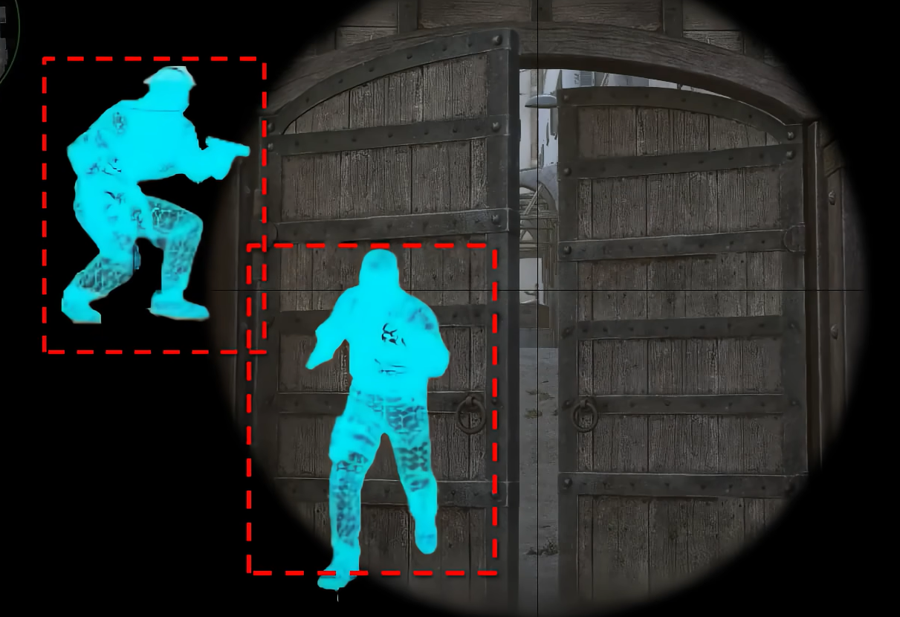
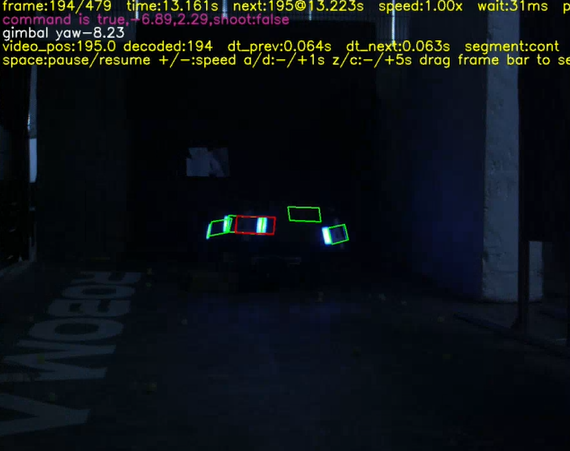
从计算机视觉的角度来讲，自瞄的目的是检测并获得目标的位置，也就是“我去，这框真帅吧”
>Q : 怎么设计逻辑把框画出来？
## 2. 图像的存储方式
图像由像素组成，像素是组成图像的最小单元。
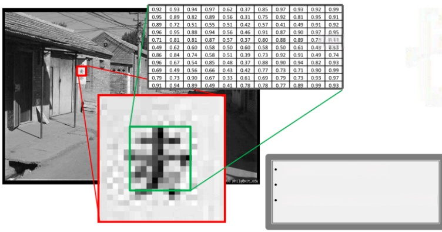

- 数据结构的角度 : 一副M×N的灰度图像可以理解为二维数组array[M][N]或者一个包含长宽和一维数组的结构体。
```cpp 
typedef struct {
    int width;      // 图像宽度（列数）
    int height;     // 图像高度（行数）
    unsigned char *data;  // 像素数据，每个像素1字节(0-255)
} GrayImage;
//data 用一维数组存储，通过 y * width + x 访问像素。这是最常用的方式，内存连续，便于各种处理。
```
- 线性代数的角度 : 一幅M×N的灰度图像可以看做一个M×N的矩阵，其中每个元素表示一个像素的灰度值；
$$
\begin{pmatrix}
a_{11} & a_{12} & \cdots & a_{1n} \\
a_{21} & a_{22} & \cdots & a_{2n} \\
\vdots & \vdots & \ddots & \vdots \\
a_{m1} & a_{m2} & \cdots & a_{mn}
\end{pmatrix}
$$
>Q：彩色图片的数据该怎么组织呢？

### 2.1 色彩空间
- 像素是组成图像的最小单元，每个像素可以看做一个多维向量或者一维数组
- 一幅M×N的彩色图像可以看做一个M×N×3的张量，其中每个元素表示一个像素的RGB三个通道的值。
- 我们可以把彩色图像看做是三个灰度图像的叠加，每个灰度图像对应一个通道，一般是红、绿、蓝三个通道。

**例：分离RGB通道(opencv,cpp)：**
```cpp
#include <opencv2/opencv.hpp>
#include <vector>

int main(int argc, char* argv[])
{
    cv::Mat src = cv::imread(argv[1]); // 读取图像
    std::vector<cv::Mat> dst;          // 存储分离后的通道

    cv::split(src, dst);               // 分离通道

    cv::namedWindow("src", cv::WINDOW_NORMAL); // 创建窗口，WINDOW_NORMAL 表示窗口大小可以调整
    cv::namedWindow("B", cv::WINDOW_NORMAL);
    cv::namedWindow("G", cv::WINDOW_NORMAL);
    cv::namedWindow("R", cv::WINDOW_NORMAL);
    cv::imshow("src", src); // 显示图像
    cv::imshow("B", dst[0]);
    cv::imshow("G", dst[1]);
    cv::imshow("R", dst[2]);

    cv::waitKey(0); // 等待窗口关闭（0表示一直等待）
    return 0;
}
```
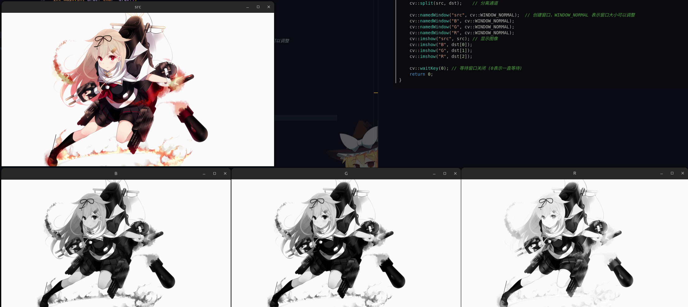
#### 2.1.1 RGB
RGB 是一种加色模型，分别用红（Red）、绿（Green）和蓝（Blue）三个分量描述颜色。每个分量通常用 8 bit 表示，取值范围为 $[0,255]$；三个分量组合后可以表示约 $256^3$ 种颜色。

需要注意，OpenCV 默认按 **BGR** 顺序存储彩色图像，而不是 RGB。因此，`cv::split` 得到的 `dst[0]`、`dst[1]`、`dst[2]` 依次是 B、G、R 通道。显示或与其他库交换图像时要确认通道顺序，否则颜色会不正确。

RGB 的三个分量与人对颜色的感知并不完全对应。在光照变化较大时，同一物体的 RGB 值也会变化，因此实际视觉任务中经常先转换到其他色彩空间，再根据任务选择合适的通道或阈值。

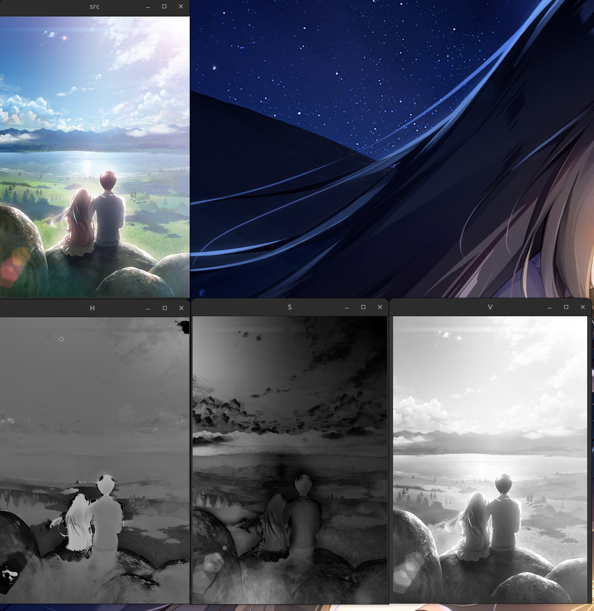

## 3. 滤波
滤波是对图像像素进行邻域运算的过程，常用于平滑噪声、突出细节或提取特征。滤波通常会改变图像的细节：平滑可以抑制噪声，但也可能模糊边缘；增强细节则可能同时放大噪声。

### 3.1 卷积
卷积通过一个较小的矩阵（卷积核，也称滤波器）在图像上滑动，对邻域像素加权求和，得到输出图像对应位置的像素值。对于灰度图像，可写为：

$$
g(x,y)=\sum_{i=-k}^{k}\sum_{j=-k}^{k}h(i,j)f(x-i,y-j)
$$

其中，$f$ 是输入图像，$h$ 是卷积核，$g$ 是输出图像。卷积核的大小和权重决定了滤波效果；计算图像边缘附近的像素时，还需要选择边界处理方式，例如复制边缘像素或反射填充。

一些常见卷积核如下：

- 均值核：邻域内权重相同，用邻域平均值替换当前像素，可平滑图像，但容易模糊边缘。
- 高斯核：中心权重大、周围权重小，能较自然地平滑图像，常用于降噪和边缘检测前的预处理。
- Sobel 核：分别近似计算水平方向和垂直方向的导数，可用于估计图像梯度和检测边缘。

在 OpenCV 中，`cv::filter2D` 可以使用自定义卷积核；常用平滑操作也有对应的专用接口，例如 `cv::GaussianBlur`。

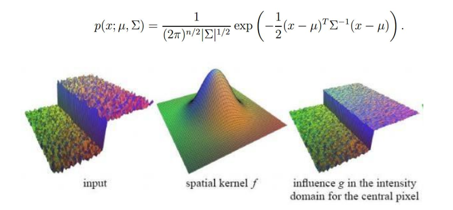

### 3.2 常见滤波器
不同滤波器适合不同类型的噪声和任务：

| 滤波器 | 基本做法 | 特点与常见用途 |
| --- | --- | --- |
| 均值滤波 | 用邻域像素的平均值替换当前像素 | 实现简单，能平滑随机噪声，但会模糊边缘 |
| 高斯滤波 | 按高斯分布对邻域加权求和 | 平滑效果自然，常作为边缘检测前的降噪步骤 |
| 中值滤波 | 将邻域像素排序后取中间值 | 对椒盐噪声效果较好，通常比均值滤波更能保留边缘 |
| 双边滤波 | 同时考虑像素间的空间距离和像素值差异 | 平滑相近颜色区域，同时尽量保留边缘；计算量相对较大 |

OpenCV 中常用的接口包括 `cv::blur`、`cv::GaussianBlur`、`cv::medianBlur` 和 `cv::bilateralFilter`。选择滤波器时要结合噪声类型和后续任务，并注意滤波过强会让小目标或细节消失。

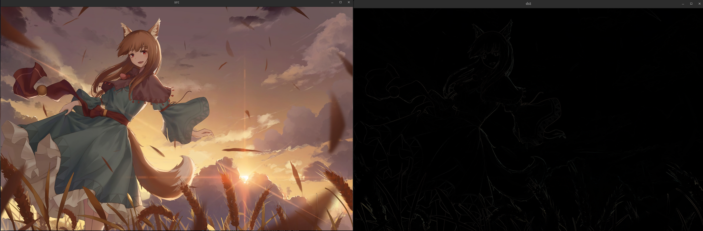

### 3.3 *频域
空间域直接处理像素及其邻域；频域则将图像表示为不同空间频率成分的组合。图像经过傅里叶变换后，可以观察和处理这些频率分量，再通过逆变换得到图像。

低频成分通常对应缓慢变化的区域和整体亮度，高频成分通常对应快速变化的细节、纹理和边缘。低通滤波削弱高频成分，可以平滑图像；高通滤波保留或增强高频成分，可以突出边缘与细节。频域方法也可以用于分析周期性噪声，但实际使用时需要关注变换、频谱中心化和逆变换等步骤。

初学阶段更常使用空间域滤波器。理解频域的意义在于知道图像中的噪声、边缘和纹理对应不同的频率成分，并能据此选择处理方法。

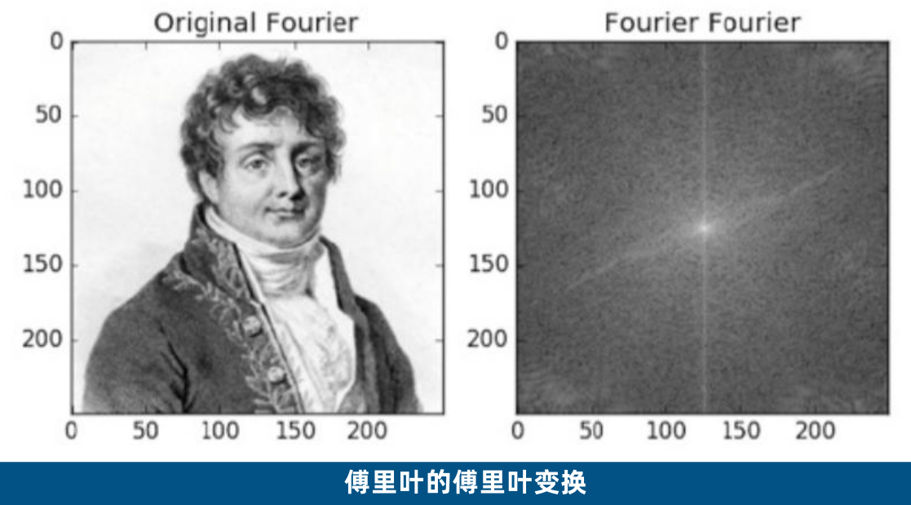

## 4. 边缘检测
边缘是图像中灰度或颜色发生明显变化的位置。物体轮廓通常表现为边缘，因此边缘检测可以帮助定位目标边界、分析形状；但纹理、阴影和噪声也可能产生边缘，检测结果并不一定就是物体轮廓。

一维情况下，边缘对应灰度函数变化较快的位置；在二维图像中，可以通过水平和垂直方向的梯度描述变化：

$$
\nabla I=\begin{pmatrix}G_x\\G_y\end{pmatrix},\qquad
|\nabla I|=\sqrt{G_x^2+G_y^2}
$$

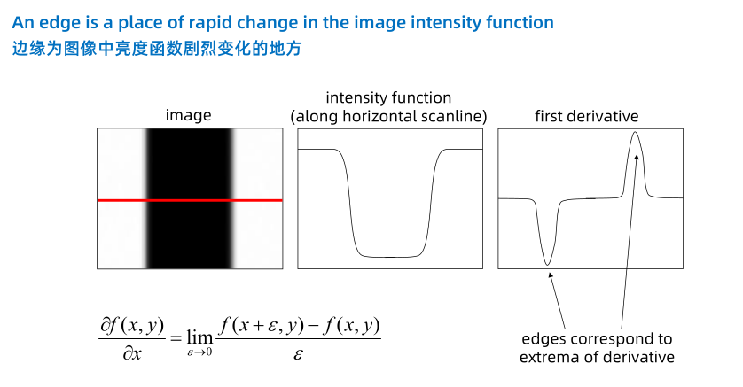

梯度方向表示灰度变化最快的方向，梯度幅值较大的位置通常是候选边缘。

### 4.1 Sobel 算子
Sobel 算子用两个 $3\times3$ 卷积核近似计算水平和垂直方向的导数：

$$
G_x=\begin{pmatrix}-1&0&1\\-2&0&2\\-1&0&1\end{pmatrix}*I,\qquad
G_y=\begin{pmatrix}-1&-2&-1\\0&0&0\\1&2&1\end{pmatrix}*I
$$

计算 $G_x$ 和 $G_y$ 后，可以组合得到边缘强度。Sobel 结构简单、计算快，但对噪声敏感，因此常在计算前进行平滑。

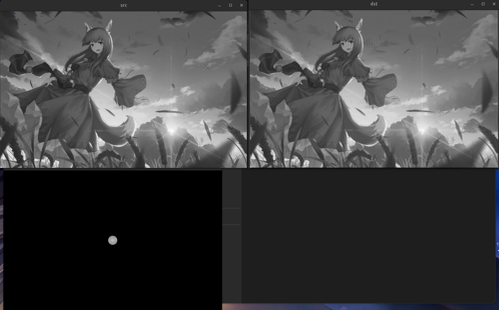

### 4.2 Canny 算子
Canny 是常用的多阶段边缘检测方法，基本流程为：

1. 使用高斯滤波平滑图像，降低噪声影响。
2. 计算梯度幅值和方向。
3. 进行非极大值抑制，只保留梯度方向上的局部最大值，使边缘变细。
4. 使用高、低两个阈值进行滞后阈值连接：高于高阈值的像素作为强边缘，介于两个阈值之间的像素只有与强边缘连通时才保留。

OpenCV 中可使用 `cv::Canny`：

```cpp
cv::Mat gray, edges;
cv::cvtColor(src, gray, cv::COLOR_BGR2GRAY);
cv::Canny(gray, edges, 50, 150);
```

两个阈值需要结合图像调整。阈值过低容易引入噪声边缘，过高则会漏掉较弱的边缘。

### 4.3 LoG 算子
LoG（Laplacian of Gaussian，高斯-拉普拉斯）先用高斯函数平滑图像，再计算二阶导数，以减弱噪声对边缘检测的影响。边缘可通过 LoG 响应的零交叉位置来寻找。由于高斯平滑和拉普拉斯运算可以组合成一个卷积核，LoG 也可以作为一个整体滤波器使用。

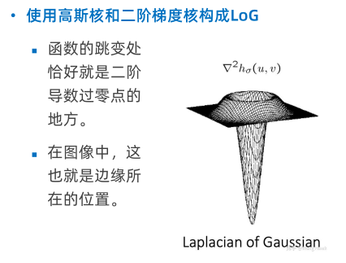

高斯函数的一阶导数也可直接用于求图像梯度；利用高斯导数进行平滑和求导，有助于降低先后执行两种操作的重复计算。

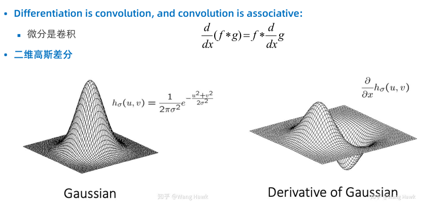

## 5. 角点检测
角点是图像中两个或多个边缘相交、灰度在多个方向都发生明显变化的位置。与只沿一个方向变化的边缘相比，角点在不同方向上都具有较明显的局部变化，因此适合用于特征匹配、跟踪和定位。

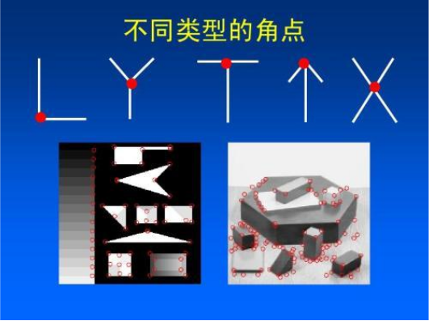

### 5.1 Harris 角点
Harris 方法分析一个小窗口沿不同方向移动时，窗口内像素变化的程度。若沿任意方向移动都会导致明显变化，该位置就可能是角点。常见的响应函数为：

$$
R=\det(M)-k\,\operatorname{trace}(M)^2
$$

其中 $M$ 由窗口内图像梯度构成，$k$ 是经验参数。响应值较大的位置是角点候选，实际应用中还需要设置阈值并对邻近候选进行筛选。

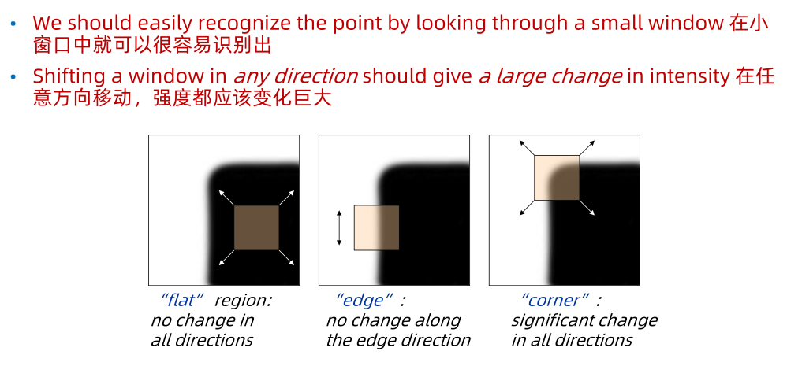

OpenCV 提供 `cv::cornerHarris` 计算 Harris 响应图。输入通常是单通道浮点图像；响应图表示候选角点强度，并不是直接标记好的角点列表。

### 5.2 Shi-Tomasi 与 FAST
Shi-Tomasi 方法根据矩阵 $M$ 的较小特征值评价角点，常用于角点检测和特征跟踪；OpenCV 的 `cv::goodFeaturesToTrack` 可以提取一组质量较好的角点。

FAST 通过比较候选像素周围一圈像素的亮度，快速判断候选位置是否像角点。它计算速度快，适合实时应用，但检测质量会受阈值和图像噪声影响。

在自瞄等实际场景中，角点检测通常是特征提取的一部分。检测到角点后还需要结合目标区域、几何约束或跟踪算法，不能把所有角点都当成目标。

## 6. 形态学
形态学是一类基于形状的图像处理方法，常用于二值图像。它通过结构元素（形态学核）在图像上移动，改变前景区域的形状，可用于去除小噪点、连接断裂区域或提取轮廓。

### 6.1 膨胀与腐蚀
**膨胀**使前景区域向外扩张：结构元素覆盖到前景时，输出位置倾向于成为前景。它可以填补小间隙、连接相邻区域，但也会让目标变大。

**腐蚀**使前景区域向内收缩：结构元素完全落在前景区域内时，输出位置才保留为前景。它可以去除小的前景噪点或分开相连区域，但也可能使细小目标消失。

效果取决于结构元素的形状、尺寸和迭代次数。结构元素越大或操作次数越多，图像形状变化通常越明显。OpenCV 中可用 `cv::getStructuringElement` 创建矩形、椭圆或十字形结构元素，再用 `cv::dilate` 和 `cv::erode` 执行操作。

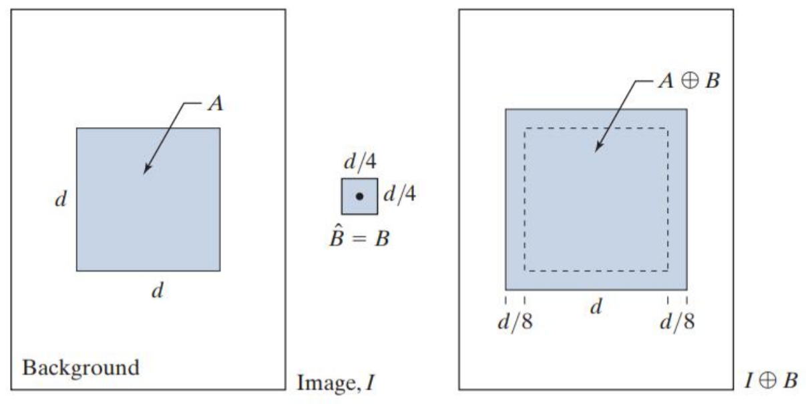
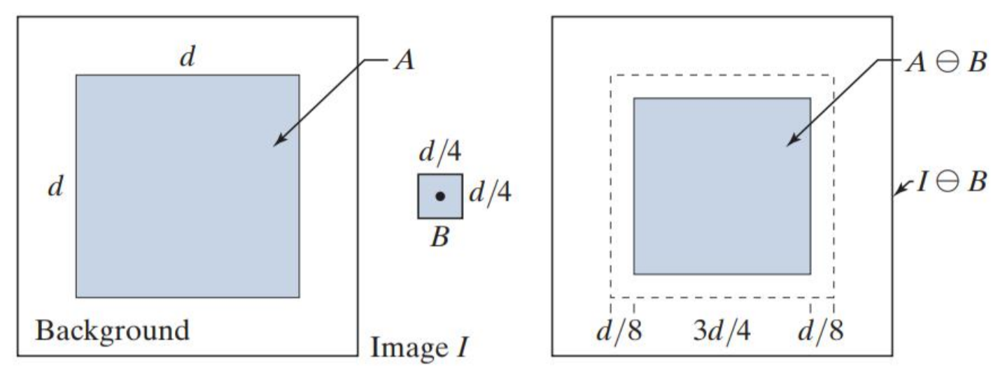
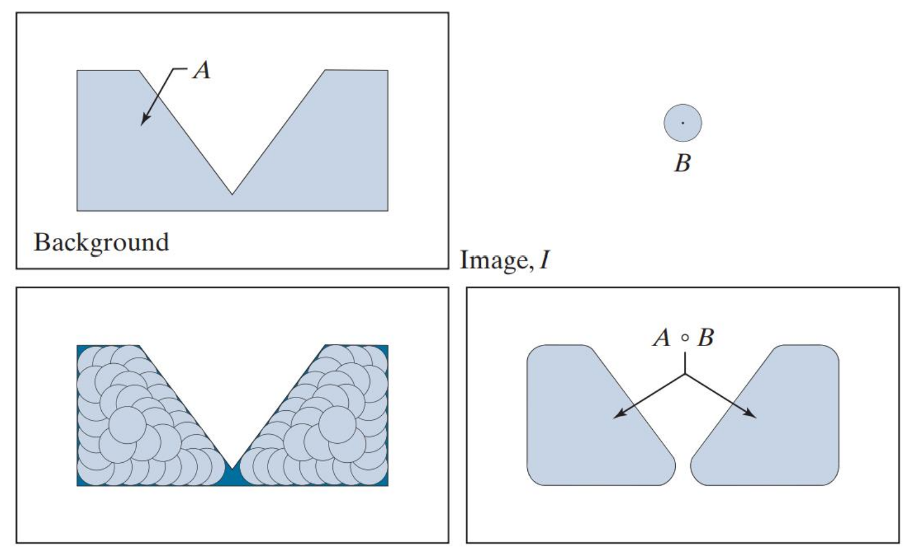
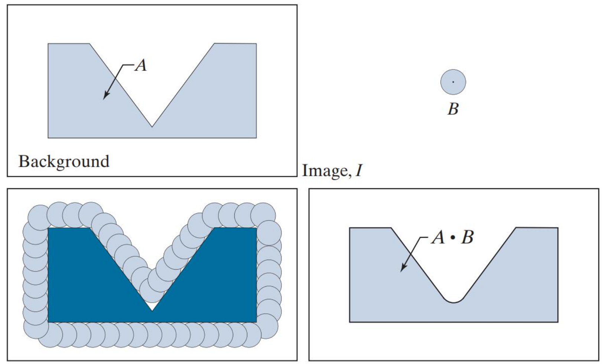

### 6.2 开运算与闭运算
开运算是先腐蚀、再膨胀：

$$
A\circ B=(A\ominus B)\oplus B
$$

它通常用于去除小的前景噪点，同时尽量保留较大的目标。

闭运算是先膨胀、再腐蚀：

$$
A\bullet B=(A\oplus B)\ominus B
$$

它通常用于填补前景内部的小孔洞或连接距离较近的区域。

OpenCV 中可以通过 `cv::morphologyEx` 使用 `cv::MORPH_OPEN` 和 `cv::MORPH_CLOSE`。形态学操作应在合适的二值图像上进行；结构元素过大时，可能改变目标原有形状或合并本来分离的目标。

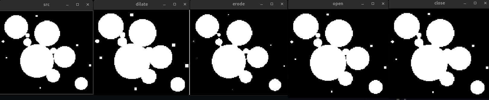

